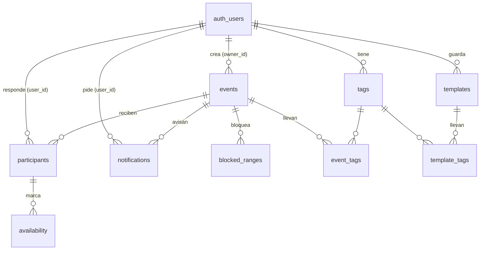

# WeMeet: arquitectura (monolito)

Versión mejorada de When2Meet, mobile-first. Estilo visual **Cake** (blanco, violeta `#4823ff`, amarillo `#e7ff6e`, gris cálido).
Los flujos de usuario con sus diagramas están en `flujos-de-usuario.md`; las decisiones de diseño, en `registro-de-decisiones.md`.

## Estado de la implementación

| Parte | Estado |
|---|---|
| Interfaz (crear reunión, responder, perfil, plantillas, ayuda) | **Hecha**. Sin base de datos todavía: ninguna reunión existe (todo `/e/…` da 404), las listas del perfil parten vacías y nada se guarda |
| Cuenta | **Sin conectar**: nadie tiene cuenta, "Sign in" está desactivado y `/perfil` pide iniciar sesión. La interfaz con cuenta (perfil, plantillas, tags) está hecha y espera sus datos |
| Base de datos y endpoints | **Por construir**; el esquema ya está listo y probado en `supabase/migrations/` |
| Cerrar la reunión y el `.ics` | Hecho (ver D-36 en el registro de decisiones) |
| Avisos por correo | Hechos (pedir, quitar, enviar por Resend, cron cada 10 min); falta verificar un dominio en Resend para enviar a cualquier correo |

## Stack
| Pieza | Elección |
|---|---|
| App | Next.js (App Router, TypeScript): páginas y API en un solo proyecto |
| UI | Tailwind v4, shadcn/ui (base-nova), Lucide, react-day-picker, selector de hora de ReUI, sonner |
| Deploy | Vercel (plan gratis); `main` se despliega, `dev` no (`vercel.json`) |
| Base de datos | Postgres en Supabase (plan gratis) |
| Acceso a datos | Solo desde el servidor (route handlers) con `postgres` o Drizzle; el navegador nunca habla directo con la base |
| Cuenta | Supabase Auth con "Continuar con Google". Sin cuenta se participa con solo un nombre |
| Correo | Resend (avisos), enviados desde un cron de Vercel |

Reglas del enunciado que condicionan esto: URL pública que abre sin instalar ni pedir cuenta, repo visible para la profesora y la ayudante, y el link debe seguir vivo hasta fines de noviembre.

## Qué es una cuenta y qué no
- **Sin cuenta**: se puede crear una reunión, responderla y pedir un aviso por correo. Al responder basta un nombre.
- **Escribir el nombre no es una cuenta.** Sirve para responder y para volver a editar la respuesta (escribir el mismo nombre, sin importar mayúsculas, carga esa respuesta). No abre el perfil.
- **Con cuenta** (Google): perfil con todas tus reuniones (creadas y respondidas), tags, plantillas y avisos.
- Un nombre no protege la respuesta: cualquiera con el link podría reescribir la de otra persona escribiendo su nombre. Es una decisión de diseño (sin contraseñas); el riesgo se acota con límite de peticiones y con que las respuestas de una reunión ya son visibles para todos los que tienen el link.

## Modelo de datos
El SQL completo y probado está en [supabase/migrations/20261026120000_init.sql](supabase/migrations/20261026120000_init.sql). Resumen:

| Tabla | Para qué | Datos clave |
|---|---|---|
| `events` | La reunión | `slug` (va en el link), `title` (1 a 80), `owner_id` (null si no hay cuenta), `owner_token` (secreto del creador), `timezone`, `days date[]` (pueden pasar de 7), `start_time`, `end_time` (`24:00` vale), `slot_minutes` (10, 15, 20, 30 o 60), `max_key` (0 a 2), `status`, `chosen_start`, `created_at` |
| `blocked_ranges` | Horarios que nadie puede marcar | `days date[]`, `start_time`, `end_time`: una regla vale para uno o más días |
| `participants` | Quien respondió | `name` (1 a 40, único por reunión sin distinguir mayúsculas), `is_key`, `user_id` (null sin cuenta), `created_at` ("Respondida el…") |
| `availability` | Los bloques en que alguien puede | una fila por bloque, como instante exacto (`timestamptz`): cada quien lo ve en su zona |
| `tags` | Tags de una cuenta | `user_id`, `name` (1 a 24 letras, único por cuenta sin distinguir mayúsculas) |
| `event_tags` | Tag puesto a una reunión | de la cuenta dueña del tag, a una reunión que creó o respondió |
| `templates` | Plantillas de una cuenta | `name` (1 a 50, único por cuenta), `slot_minutes`, `start_time`, `end_time`, `max_key`, `blocked jsonb` |
| `template_tags` | Tags de una plantilla | |
| `notifications` | Avisos por correo | `email`, `kind` (`count`, `date`, `datetime`), `target_count`, `notify_at`, `status` (`pending`, `sent`, `cancelled`), `cancel_token`, `user_id` (null sin cuenta) |
| `profile_events` (vista) | La lista del perfil | una fila por reunión de la cuenta: `role` (`creada` o `respondida`), `role_date`, `response_count` |

### Reglas que la base hace cumplir (triggers y restricciones)
| Regla | Dónde |
|---|---|
| Máximo de integrantes clave por reunión (`max_key`) | trigger en `participants` |
| Un nombre por reunión, sin distinguir mayúsculas ni espacios de más | índice único en `participants` |
| 24 letras por tag, 5 tags por reunión, 5 por plantilla y 30 por cuenta | checks y triggers en `tags`, `event_tags`, `template_tags` |
| Un tag deja de existir cuando ya no está en ninguna reunión ni plantilla | trigger que borra los huérfanos |
| Un solo aviso pendiente por correo y reunión, y uno por cuenta y reunión | índices únicos parciales en `notifications` |
| La forma del aviso (`count` lleva cantidad, `date` y `datetime` llevan fecha) | check en `notifications` |
| Hora de término posterior a la de inicio; reunión cerrada si y solo si tiene `closed_at` | checks en `events`, `blocked_ranges`, `templates` |
| Todo cerrado al navegador: RLS activado sin políticas; solo el servidor (service role) accede | todas las tablas; la vista se cierra con `revoke` |

Lo que valida la API además (no se puede expresar bien en SQL): que los días de un bloqueo sean días de la reunión, que el horario sea múltiplo del bloque, y que los bloques marcados caigan en un día y una hora de la reunión y no estén bloqueados.

**Se quitó respecto a la primera versión:** la fecha límite (`deadline`), el `token` por participante (la identidad es el nombre) y el campo `day` único de los bloqueos (ahora `days`).

## Páginas
| Ruta | Qué es | Quién |
|---|---|---|
| `/` | Crear reunión: nombre, días, horario, bloque, horarios bloqueados, integrantes clave, zona; con cuenta, también tags y plantillas propias | todos |
| `/?plantilla=<id>` | Lo mismo, con una plantilla de la cuenta ya aplicada | con cuenta (si no, se ignora) |
| `/e/[slug]` | La reunión: acceso por nombre, Mi horario, Respuestas, Compartir (celular: pestañas; computador: dos grillas a la vez y Compartir flotante) | todos |
| `/perfil` | Pestañas Reuniones y Plantillas | solo con cuenta; sin cuenta, pide iniciar sesión |
| `/how-to`, `/faq` | Ayuda, una página fija, separada por pantalla (`#crear`, `#perfil`…) | todos |
| `not-found` | Cuando el link no lleva a ninguna parte (por ejemplo, una reunión que no existe) | todos |

## Endpoints
Todos pasan por el servidor. Los de `/api/me/*` exigen sesión (cookie de Supabase Auth); los demás son públicos. Los errores devuelven `{ error: "mensaje para la persona" }` con el código HTTP que corresponda (400 validación, 401 sin sesión, 403 sin permiso, 404 no existe, 409 conflicto, 429 muchas peticiones).

**Implementado (28 oct):** `POST /api/events`, `GET /api/events/[slug]`, `PUT /api/events/[slug]/responses`, `GET /api/cron/limpieza`, el login (`/auth/login`, `/auth/callback`) y todos los `/api/me/*` y los avisos por correo. Sin sesión, `/api/me/*` responde `401`. Con sesión, `POST /api/events` guarda `owner_id` y los `etiquetas` (tags) de la reunión, y `PUT …/responses` guarda `user_id`. La sesión vive en cookies de Supabase Auth (`@supabase/ssr`); `src/proxy.ts` renueva el token, y cerrar sesión se hace desde el navegador (no hay `POST /auth/signout`). Las plantillas se duplican desde la interfaz, creando una nueva con `POST` (no hay endpoint `duplicate`). El servidor usa `@supabase/supabase-js` con la llave secreta (`src/server/db.ts`) y valida con `zod`; lo que debe guardarse junto va en funciones SQL (`create_event`, `save_response`, `purge_stale_events`, en `supabase/migrations/20261028120000_funciones.sql`), que solo puede llamar el servidor. La grilla habla en bloques `"AAAA-MM-DD|fila"` (hora de la zona de la reunión); el servidor los convierte a instantes (`timestamptz`) con `@date-fns/tz` y de vuelta. Tope de 120 días por reunión (`src/lib/limites.ts`).

### Reuniones (públicos)
| Método y ruta | Qué hace | Cuerpo / respuesta |
|---|---|---|
| `POST /api/events` | Crea la reunión | La misma forma que `Reunion` en `src/lib/reunion.ts`: `{ titulo, zona, dias[], desde, hasta, bloqueMin, claves, bloqueos: [{ id, dias[], desde, hasta }] }` → `201 { slug, tokenDueno }`. Con sesión también guardará `owner_id` y los tags *(pendiente)* |
| `GET /api/events/[slug]` | Los datos de la reunión y todas las respuestas | → `{ slug, reunion, personas: [{ nombre, clave, disp[] }], cerrada }`, con `disp` en bloques `"AAAA-MM-DD\|fila"` y `cerrada` el bloque elegido (o `null` si sigue abierta). No incluye quién la creó. `404` si no existe |
| `PUT /api/events/[slug]/responses` | Guarda (crea o reemplaza) una respuesta por nombre | `{ nombre, clave, bloques[] }` → `200 { clave, claveDenegada }`. Si ya no hay lugar de integrante clave se guarda igual como participante normal (`claveDenegada: true`, no es un 409). `400` si algún bloque no existe; `409` si la reunión está cerrada. Con sesión fijará `user_id` *(pendiente)* |
| `POST /api/events/[slug]/close` | Cierra la reunión con el horario elegido | `{ bloque: "AAAA-MM-DD\|fila", tokenDueno? }` → `200`. Solo su creador: con sesión si la cuenta es la dueña, o con el `tokenDueno` que devolvió `POST /api/events` (el navegador lo guarda en `localStorage`). `403` si no es el creador, `400` si el bloque no existe o está bloqueado, `409` si ya está cerrada. Desde entonces `PUT …/responses` responde `409` |
| `POST /api/events/[slug]/reopen` | Reabre una reunión cerrada | `{ tokenDueno? }` → `200`; mismo permiso. Borra `chosen_start` y `closed_at`. **La interfaz no lo usa** (se decidió que una reunión cerrada queda cerrada, D-39) |
| `GET /api/events/[slug]/ics` | Descarga el `.ics` del horario confirmado | `text/calendar`, un evento de `slot_minutes` minutos con la hora en UTC. `404` si la reunión sigue abierta |
| `POST /api/events/[slug]/notifications` | Pide un aviso por correo | `{ tipo: "personas", personas, correo }`, `{ tipo: "fecha", fecha, correo }` o `{ tipo: "fecha-hora", fecha, hora, correo }` (fecha y hora en la zona de la reunión; "fecha" a secas llega ese día a las 9:00) → `201 { id, tokenCancelar }`. `400` si la fecha ya pasó, la cantidad ya se alcanzó o el correo no es válido; `409` si ya hay uno pendiente para ese correo (o para esa cuenta) en la reunión o si la reunión está cerrada; `429` si ese correo ya tiene 5 avisos pendientes o la reunión recibió 30 pedidos en una hora. Con sesión, queda ligado a la cuenta (`user_id`) |
| `GET /api/events/[slug]/aviso` | El aviso pendiente de quien pregunta | → `{ id, aviso: { tipo, personas?, fecha?, hora?, correo } }` o `null`. Con sesión, el de su cuenta; sin cuenta, el que pidió desde este navegador (`?id=` y `?token=` con la llave que recibió) |
| `DELETE /api/notifications/[id]` | Quita un aviso pendiente (pasa a `cancelled`) | `204`. Su dueño con la sesión, o quien lo pidió sin cuenta con `?token=<tokenCancelar>`; `403` si no es suyo; `404` si ya se envió o no existe |

### Cuenta (con sesión)
| Método y ruta | Qué hace | Cuerpo / respuesta |
|---|---|---|
| `GET /api/me/events` | La lista del perfil: las reuniones creadas y respondidas (una sola vez cada una) | → `[{ slug, titulo, tags[], respuestas, rol: "creada"\|"respondida", fecha (instante ISO), aviso: null }]`. Los filtros y el orden se hacen en el navegador |
| `POST /api/me/events/[slug]/tags` | Pone un tag a una reunión de la cuenta (lo crea si no existe, sin distinguir mayúsculas) | `{ nombre }` → `201`. `409` si la reunión ya tiene 5 tags o la cuenta ya tiene 30; `404` si la cuenta no creó ni respondió esa reunión |
| `DELETE /api/me/events/[slug]/tags/[name]` | Quita un tag de una reunión (si queda sin uso, desaparece) | `204` |
| `GET /api/me/tags` | Tus tags con en cuántas reuniones y plantillas está cada uno | `[{ name, count }]` |
| `GET /api/me/templates` | Tus plantillas, las más nuevas primero | `[{ id, nombre, detalle, bloqueMin, desde, hasta, claves, bloqueos: [{ desde, hasta }], tags[] }]` |
| `POST /api/me/templates` | Crea una plantilla | `{ nombre, bloqueMin, desde, hasta, claves, bloqueos[], tags[] }` → `201` con la plantilla. `409` si el nombre se repite; `400` si algo no es válido |
| `PUT /api/me/templates/[id]` | Reemplaza una plantilla | igual que el anterior → `200`; `409` si el nombre ya lo tiene otra |
| `DELETE /api/me/templates/[id]` | La borra (las reuniones ya creadas no cambian) | `204` |

### Sesión y tareas programadas
| Método y ruta | Qué hace |
|---|---|
| `GET /auth/login?next=/ruta` | Empieza el inicio de sesión con Google y, al terminar, vuelve a `next` (solo rutas de la app) |
| `GET /auth/callback` | Vuelta de Google: cambia el código por la sesión (cookies) y redirige a `next`; si falla, vuelve con `?error=login` |
| `GET /api/cron/limpieza` | Cron de Vercel (diario, con `CRON_SECRET`): borra las reuniones sin respuestas hace 2 meses (o sin ninguna y creadas hace 2 meses), con todo lo que cuelga de ellas. Al tocar la base a diario evita que Supabase pause el proyecto |
| `GET /api/cron/avisos` | Con `Authorization: Bearer <CRON_SECRET>`: envía los avisos `date` y `datetime` cuyo `notify_at` ya pasó y revisa de nuevo los `count`. Lo llama el workflow de GitHub Actions `.github/workflows/avisos.yml` **cada 10 minutos** (Vercel en el plan gratis solo permite un cron al día, así que `vercel.json` lo llama además una vez al día como respaldo) |

**Avisos por correo (implementado):** el correo sale por Resend (`src/server/correo.ts`, variables `RESEND_API_KEY` y `EMAIL_FROM`); sin la clave, en desarrollo se imprime en la consola. Un aviso se manda **una sola vez**: primero se "reclama" (`pending` → `sent`) para que dos procesos no lo manden doble, y si el envío falla vuelve a `pending` (se reintenta en el siguiente ciclo, hasta 24 h después de su hora; después se cancela). El aviso "cuando respondan N personas" se revisa justo después de guardar cada respuesta (`PUT …/responses`, con `after()`, sin hacer esperar a quien responde) y el cron lo repasa por si alguno se quedó sin enviar. Al cerrar la reunión, los avisos pendientes se cancelan. El correo trae el resumen de la reunión (el mismo texto de "Copiar resumen") y un botón "Ver la reunión". El perfil muestra el aviso real de cada reunión (`aviso` y `avisoId` en `GET /api/me/events`).

## Login
**Continuar con Google**, usando Supabase Auth. Sin contraseñas ni correos de verificación: un botón, Supabase guarda la sesión. Configuración única: crear un cliente OAuth en Google Cloud y pegar su id y secreto en Supabase.

Se descartó el link al correo: el correo incluido en el plan gratis de Supabase solo envía unos pocos mensajes por hora, y a otros usuarios no les llegaría de forma confiable, lo que rompería la evaluación del otro grupo.

Hoy: `useSesion()` en `src/lib/sesion.ts` siempre devuelve "sin cuenta". Al conectar Supabase Auth, ese hook lee la sesión real y es lo único que cambia en la interfaz. Los datos que la interfaz espera están marcados en el código: `obtenerReunion` (`src/lib/reuniones.ts`), las props `reunionesIniciales` y `plantillasIniciales` del perfil, y `plantillasPropias` y `tagsDeLaCuenta` de crear reunión.

## Límites y validaciones (iguales en pantalla y en la API)
| Qué | Límite |
|---|---|
| Nombre de la reunión | 1 a 80 letras |
| Nombre de quien responde | 1 a 40 letras; único en la reunión sin distinguir mayúsculas |
| Días de la reunión | al menos 1; si son más de 7, se muestran por semanas (lunes a domingo) |
| Duración del bloque | 10, 15, 20, 30 o 60 minutos |
| Integrantes clave | 0 a 2 por reunión |
| Tags | 24 letras; 5 por reunión; 5 por plantilla; 30 por cuenta |
| Plantillas | nombre de 1 a 50 letras, único por cuenta |
| Aviso por correo | uno pendiente por correo y reunión; no se edita, se quita y se pide otro |

## Las tareas de las entregas
1. Crear una reunión con horario, bloques e integrantes clave.
2. Responder la disponibilidad y verla guardada.
3. Ver las respuestas y copiar el resumen para el grupo.
4. *(Con cuenta)* Encontrar una reunión en el perfil por sus tags.

## Fuera de la primera entrega
Cerrar la reunión con invitación al calendario, envío real de avisos por correo, y todo lo que dependa de la base de datos (hoy la interfaz no guarda nada).
